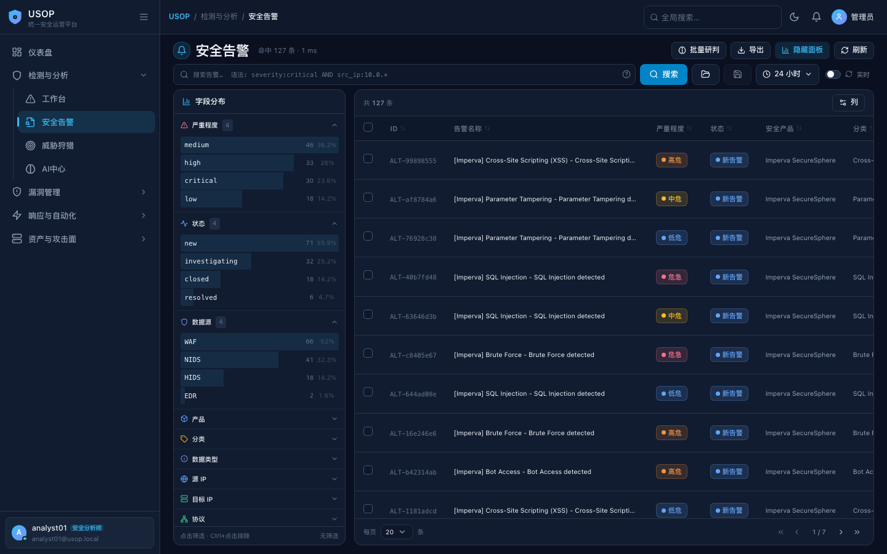

<p align="center">
  
</p>

<p align="center">
  <b>USOP</b> · 统一安全运营平台（Unified Security Operations Platform）
</p>

<p align="center">
  一套前后端分离的一体化安全运营平台，覆盖从日志接入、解析标准化、检测关联、AI 研判到事件处置闭环的完整安全运营链路。
</p>

<p align="center">
  
  
  
</p>

---

## What is USOP?

USOP（Unified Security Operations Platform）是一套前后端分离的一体化安全运营平台，覆盖从**日志接入、解析标准化、检测关联、AI 研判到事件处置闭环**的完整安全运营链路。

> 核心数据流：`日志源 → Kafka → 解析管道（标准化/过滤/去重）→ Elasticsearch（告警唯一真相源）→ Flink 关联分析 → PostgreSQL（事件/业务）`

## Why USOP?

- **一体化运营闭环**：日志接入、检测、研判、响应、资产/漏洞管理在一个平台内完成，无需在多套工具间切换。
- **告警唯一真相源 = Elasticsearch**：所有告警以 ES 为权威存储，PG 仅存业务关联，避免双写不一致与 `Alert.query` 死路。
- **自动化响应剧本**：可视化编排 + 审批流 + 执行记录，把 response playbook 变成可复用、可审计的运营资产。
- **可扩展接入**：Kafka 接入 + ParseProfile 字段映射，支持 9 种解析方式，新设备 / 新日志源即接即用。

## Features

| 能力 | 说明 |
| --- | --- |
| 安全告警与 AI 研判 | 告警检索、详情研判、聚合分析、AI 批量研判（自动闭环 / 误报标记 / 高危建事件） |
| 事件工作台 | 五节点状态机流转（new → acknowledged → investigating → resolved → closed） |
| 响应剧本与自动化 | 剧本编排、审批流、执行记录、封堵名单、通知与 HTTP 集成 |
| 资产与漏洞管理 | 资产盘点 / 攻击面 / 扫描；主机 · 应用漏洞全生命周期、重评、附件 |
| 数据采集与解析 | Kafka 接入、ParseProfile 映射、9 种解析方式 |
| 权限与系统 | RBAC（4 系统角色 + 集中式写守卫）、AD 域认证、审计、全局配置 |

## 模块与路由

| 模块     | 路由                       | 说明                                                                      |
| ------ | ------------------------ | ----------------------------------------------------------------------- |
| 安全告警   | `/detection/alerts`      | 告警检索、详情研判、聚合分析、AI 批量研判（告警唯一真相源 = ES）                                    |
| 事件工作台  | `/detection/events`      | 安全事件处置，五节点状态机流转（new → acknowledged → investigating → resolved → closed） |
| 威胁狩猎   | `/detection/hunting`     | 交互式查询构建与狩猎任务                                                            |
| AI 中心  | `/detection/ai`          | 模型管理、告警监控流水线、智能调查                                                       |
| AI 研判  | `/detection/ai-judgment` | 批量研判任务与结果查看                                                             |
| 响应剧本   | `/response/playbooks`    | 自动化响应剧本编排（含审批流）                                                         |
| 检测规则   | `/response/rules`        | 检测规则管理（手动执行，命中生成事件）                                                     |
| IP 名单  | `/response/ip-lists`     | 黑白名单管理                                                                  |
| 资产盘点   | `/assets/inventory`      | 资产指纹与管理                                                                 |
| 扫描任务   | `/assets/scans`          | 资产扫描调度                                                                  |
| 漏洞管理   | `/vulnerabilities*`      | 主机/应用漏洞、漏洞评估                                                            |
| 数据采集   | `/data/ingestion`        | 数据源纳管（Kafka topic）、解析管道、字段模板                                            |
| 存储表    | `/data/templates`        | 告警/事件字段模板与存储表                                                           |
| 资源中心   | `/data/resources`        | IP 组、资源等共享资源                                                            |
| 告警过滤   | `/data/alert-filters`    | 分流过滤规则与白名单                                                              |
| 运营 KPI | `/operations/kpi`        | 运营指标总览                                                                  |
| 系统管理   | `/system/*`              | 用户（含 AD 域账号）、角色、审计、备份、全局配置                                              |

## 技术栈

| 层   | 技术                                                                                       |
| --- | ---------------------------------------------------------------------------------------- |
| 前端  | React 18 + TypeScript + Webpack 5 + Tailwind CSS 3 + framer-motion + ECharts（HashRouter） |
| 后端  | Python Flask（蓝图模块化）+ SQLAlchemy + JWT                                                    |
| 消息  | Apache Kafka（KRaft 模式）                                                                   |
| 检索  | Elasticsearch（告警唯一真相源）                                                                   |
| 流计算 | Apache Flink（关联分析常驻作业）                                                                   |
| 业务库 | PostgreSQL                                                                               |
| 缓存  | Redis（去重窗口）                                                                              |

## 快速开始

```bash
# 1. 启动全部容器（usop_all / usop_postgres / redis / kafka / elasticsearch / flink*）
./start.sh

# 2. 访问
#    前端（nginx）:  http://localhost:3266
#    后端 API:       http://localhost:5001（经 3266 反代 /api/*）
#    Flink UI:       http://localhost:8081
#    Elasticsearch:  http://localhost:9200

# 3. 前端开发模式（热更新）
cd web && npm run dev    # webpack dev server :9000

# 4. 前端生产构建发版
cd web && ./node_modules/.bin/webpack --mode production
docker exec usop_all sh -c 'rm -rf /app/static/*'
docker cp web/dist/. usop_all:/app/static/
```

默认登录：`admin`（本地账号）。支持 AD 域账号登录，在「全局配置 → AD 域认证」中配置 LDAP 域控。

## 目录结构

```
usop/
├── web/                    # 前端 React + TS（webpack 构建，产物部署到容器 /app/static）
├── server-python/          # Flask 后端
│   ├── app/
│   │   ├── routes/         # 30 个 API 蓝图（alerts_api / events_api / ai_judgment / ...）
│   │   ├── models/         # SQLAlchemy 模型
│   │   ├── utils/          # es_alerts.py（告警统一入口）/ ldap_auth.py（AD 认证）等
│   │   └── engine/         # playbook 引擎 / 检测动作
│   └── migrations/         # 手写幂等迁移脚本（无 Alembic）
├── flink-jobs/             # Flink 作业（关联分析 / 告警引擎 / 日志解析）
├── postgres/               # 数据库初始化脚本
└── docker-compose.yml      # 基础设施编排
```

## 数据采集接入（Beats / Logstash → Kafka）

平台采集入口是 **Kafka**。采集端（Filebeat / Logstash / 其它生产者）把日志发到**设备 topic**，平台纳管该 topic 后经解析管道自动完成：标准化 → 过滤/去重 → 存入 ES（`valid-alerts` / `invalid-alerts`）。

```
日志源 → Filebeat/Logstash → Kafka(设备topic) → 标准化(ParseProfile) → 过滤/去重 → valid/invalid-alerts → ES
                                                                                    └→ Flink 关联分析 → PG events
```

### 1. Kafka 连接信息

| 参数      | 值                                        |
| ------- | ---------------------------------------- |
| 主机侧地址   | `localhost:9092`（PLAINTEXT，容器映射宿主机 9092） |
| 容器网络内地址 | `kafka:29092`                            |
| 协议      | PLAINTEXT（无 TLS/SASL，本地部署默认）             |

### 2. Topic 约定

- **设备 topic 自由命名**，建议 `<设备类型>-<数据类型>`，如 `waf-alert`、`ids-raw`、`winlogbeat-event`。
- **系统 topic 禁止作为采集目标**（平台自用，建/写都会被拒绝）：  
  `raw-logs`、`standardized-alerts`、`valid-alerts`、`invalid-alerts`（及 `processed-alerts`）。

### 3. Filebeat 直发 Kafka

`filebeat.yml` 最小可用配置（一行一条 JSON，平台可直接解析）：

```yaml
filebeat.inputs:
  - type: filestream
    id: waf-log
    paths:
      - /var/log/waf/access.log

output.kafka:
  hosts: ["localhost:9092"]        # 容器网络内部署填 kafka:29092
  topic: "waf-alert"               # 设备 topic，需与平台纳管名一致
  required_acks: 1
  compression: gzip
  worker: 2
  max_message_bytes: 10485760      # 10MB，超长日志调大

# 建议关掉自带 metadata，发裸消息，减少平台解析负担
processors:
  - drop_fields:
      fields: ["agent", "ecs", "input", "log.offset"]
```

其它 Beat 同理（`winlogbeat` / `auditbeat` / `metricbeat` 都支持 `output.kafka`），改 `topic` 即可。注意：Beats 发出的消息默认带 `@timestamp`、`message` 字段，平台解析时按 JSON 提取即可。

### 4. Logstash 转发（多源汇聚场景）

设备多、格式杂时，用 Logstash 做汇聚层：`beats/syslog/tcp 输入 → 过滤 → kafka 输出`。

```ruby
# logstash.conf
input {
  beats  { port => 5044 }                 # 各类 Beat 汇聚
  syslog { port => 5514 }                 # 传统设备 syslog 直发
  tcp    { port => 5140  codec => json }  # 脚本/探针 JSON 直推
}

filter {
  # 可选：补字段、打标。不要过度加工，解析交给平台 ParseProfile
  mutate { add_field => { "[@metadata][topic]" => "ids-alert" } }
}

output {
  kafka {
    bootstrap_servers => "localhost:9092"
    topic_id => "%{[@metadata][topic]}"
    codec => json_lines                 # 一行一条 JSON，平台首选
    compression_type => "gzip"
  }
}
```

> 若设备只能发 syslog/原始文本，直接发文本也可以——在平台「数据采集 → 解析配置」里按样本配置解析方式（支持 `auto / json / regex / template / syslog / cef / keyvalue / csv / grok` 9 种），无需采集端做格式化。

### 5. 平台侧纳管步骤

1. 「数据采集 → 数据源管理」新建数据源：协议 `kafka`，填写 topic 名（即上一步采集端发送的 topic）；保存即自动创建并纳管该 topic。
2. 为该数据源配置**解析方式**（ParseProfile）：提供一条真实样本，选 JSON/regex/grok 等方式并映射到平台标准字段（`rule_name / severity / src_ip / dst_ip / attack_type ...`）。
3. 保存后管道自动运行：设备 topic → 标准化 → 过滤/去重 → ES。可在「告警过滤」配置分流规则，在「安全告警」页面验证数据到达。
4. 暂停/恢复消费：`POST /api/pipeline/topics {datasource_id, action: pause|resume}`。

### 6. 消息格式建议

- **首选**：一行一条 JSON 对象（`codec => json_lines` / Filebeat 默认 JSON），字段名与平台标准字段对齐时零解析成本。
- **兼容**：原始单行文本 / syslog / CEF —— 交给 ParseProfile 解析。
- 时间字段建议 ISO8601（`2026-10-18T19:30:00`），缺省时平台按入库时间兜底。


## 漏洞管理（主机漏洞 / 应用漏洞）

参考常规漏洞管理系统（Tenable/Qualys 的 RBVM 体系）实现的全生命周期管理，页面 `web/src/pages/VulnerabilityManagement.tsx`（`/vulnerabilities/host`、`/vulnerabilities/application` 两个 Tab 复用同一组件），API `app/routes/vulnerabilities_api.py`：

- **双表模型**：`vulnerabilities`（漏洞定义/知识库：CVE/CNVD/CNNVD/CWE、CVSS v3/v2 评分与向量、漏洞类别、修复建议、参考链接）+ `asset_vulnerabilities`（资产漏洞实例：编号 VH-/VA-、位置（IP/端口/协议/URL/组件版本）、处置跟踪、重评信息、时间线）。字段迁移见 `migrations/add_vuln_fields.py`（幂等，含 `vuln_class` 列）。
- **录入**：页面「录入漏洞」弹窗（`POST /vulnerabilities`）——按名称/CVE 自动复用或创建漏洞定义；资产按 IP 自动匹配，不存在则自动创建；`source=manual`。Nessus 导入（`/nessus/import`）走同一实例表。
- **状态机**（`VULN_STATUS_FLOW`，服务端强校验）：`open → in_progress → fixed → closed`；旁路 `ignored` / `risk_accepted`；`fixed` 可退回 `in_progress`（复测不通过）；`closed/ignored/risk_accepted` 可重开。每次流转写时间线并记录说明；关闭记录复测人/时间/结果。批量流转走 `/batch-status`（逐条校验，失败返回原因）。
- **重新评级（双轨制）**：原始 CVSS 评级保留不动；重评 = 业务因子加权（资产重要性 0.3 + 可利用性 0.4 + 修复难度 0.3，10 分制）→ ≥9 危急 / ≥7 高危 / ≥4 中危 / 其余低危；支持人工覆盖分数；必须填重评理由；历史重评留在 `assess_history`。评级配置页（`vulnerability_assessment_api.py`）的六因子权重体系独立存在。
- **防重复**：列表按「重评等级 ?? 原始等级」排序（危急→低危），服务端分页 + search（编号/CVE/名称/IP）+ severity/status 过滤；`/stats` 按类型返回等级/状态分布。
- **处置跟踪**：责任人/处置方案/计划完成时间/备注（`PUT /vulnerabilities/<id>`），详情弹窗展示处置跟踪块 + 重评历史 + 完整时间线。
- **附件（截图/报告）**：漏洞详情弹窗可上传多个附件（`POST /vulnerabilities/<id>/attachments`，multipart 字段 `file`）——图片（png/jpg/jpeg/gif/webp/bmp）自动归类为「截图」并生成缩略图与大图预览，其余（pdf/word/excel/csv/txt/md/log/json/zip）归为「报告」，限 20MB。落盘目录 `server-python/app/uploads/vuln_attachments/`（容器内 `/app/app/uploads/...`，bind mount 持久化），下载/预览走 `GET .../attachments/<att_id>`（带 JWT，前端 fetch+blob）。上传/删除写入处置时间线；删除漏洞时级联清理附件文件与记录（`vulnerability_attachments` 表）。

---

## License

本项目为**内部安全运营平台**，仓库当前未包含公开授权文件（LICENSE）。未经授权请勿将代码用于商业或对外分发。平台对接第三方组件（如 Tracecat、Shuffle、Elasticsearch、Flink）时请各自遵守其对应许可证条款。
